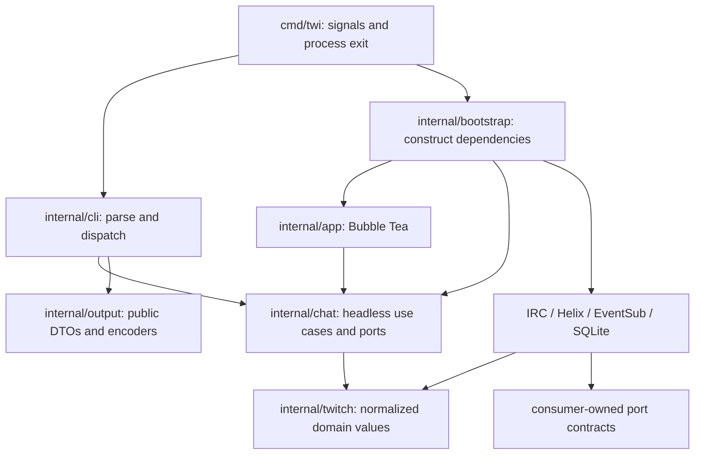

# twi: automation CLI, recorded chat history, and maintainability plan

Prepared 2026-10-11 against repository HEAD `b924905` (0.18.0 release line).
Status: original implementation design; implementation delivered 2026-10-12.
See [implementation and verification](docs/automation-validation.md) for shipped
slices, acceptance evidence, and explicit release-validation boundaries. The
dependency refresh was completed separately in this working tree.

Navigation: [commands](#4-command-surface-and-compatibility-contract),
[consumer](#5-consumer-contract), [producer](#6-producer-contract),
[output](#7-output-errors-and-process-behavior),
[history](#8-durable-history-and-recorder),
[architecture](#9-architecture-and-code-structure),
[backlog](#10-prioritized-improvement-backlog),
[milestones](#11-delivery-plan-and-review-boundaries),
[tests](#12-verification-and-acceptance-matrix),
[dependency refresh](#14-dependency-refresh-completed-and-ui-v2-follow-up).

## 1. Recommended direction

Keep the existing TUI and add explicit, composable commands to the same binary:
`twi produce` / `twi -P`, `twi consume` / `twi -C`, and a foreground
`twi record` process. Reuse authentication, normalized Twitch events, channel
resolution, and connection lifecycle through services independent of Bubble Tea.
Use newline-delimited JSON by default; offer stable, safe text output.

The essential distinction is between **live messages** and **previously recorded
messages**. The documented Twitch interfaces do not provide a general endpoint
for arbitrary recent chat history. Consequently, “last 10 messages” and “last
10 minutes” require a recorder that was already running. Never turn such a request
into “wait for the next 10 messages” or silently return an incomplete time window.
This conclusion follows from the current [API catalog](https://dev.twitch.tv/docs/api/reference/)
and the [documented receive mechanisms](https://dev.twitch.tv/docs/chat/irc/);
it is a capability assessment, not a guarantee about future Twitch APIs.

Use the existing IRC adapter first for live reading, and the Helix Send Chat
Message API for acknowledged production. Add EventSub as a subsequent reader
adapter: Twitch currently recommends EventSub and its API for chat integrations.
Preserve IRC and TUI compatibility while migrating deliberately.
[Twitch chat overview](https://dev.twitch.tv/docs/chat/)

Deliver the feature in slices. A live-only CLI is a useful first release, but the
requested feature is not complete until durable recording, historical queries,
relative time selection, and replay-follow are implemented.

## 2. Repository assessment

### Existing behavior and assets to retain

The repository has 242 Go files, including 101 test files, at the reviewed
baseline. These are inventory counts, not a coverage measurement.

| Area | Evidence | Implication |
| --- | --- | --- |
| Entry and dispatch | `cmd/twi/main.go:9`; `internal/cli/cli.go:328` | One binary already supports several subcommands. No arguments currently print help; preserve that behavior. |
| TUI launch | `internal/cli/cli.go:397`, `:437` | `twi chat` is the TUI entry point. Config, credentials, identity lookup, client construction, and rendering are currently composed together. |
| CLI compatibility | `internal/cli/cli.go:366`, `:714` | Preserve `chat --channel`, `--channels`, `--mock`, config commands, and theme `profile` commands. “Profile” already means a theme, not an account. |
| Domain and adapters | `internal/twitch/client.go:8`; `internal/twitch/messages.go:50`; `internal/twitch/boundary_test.go` | Normalized messages and a transport boundary already exist. Keep transport payloads and HTTP out of the domain. |
| Session lifecycle | `internal/app/live_chat.go:424`, `:540` | Reconnection, generation guards, cancellation, and session replacement are valuable, but currently live under the app package. Extract rather than duplicate. |
| Send semantics | `internal/app/live_chat.go:211`; `internal/twitch/irc/client.go:420` | A nil return from a void IRC enqueue becomes a locally synthesized `AcceptedAt`. This is not a Twitch acceptance acknowledgement. |
| UI history | `internal/app/channel_state.go:11`, `:253` | Per-channel memory scrollback exists; no durable chat log or restart-safe cursor exists. Local echoes must not become received-history records. |
| Overload | `internal/twitch/irc/client.go:212`; `internal/app/live_chat.go:830` | Two buffers can discard messages. This protects keepalives/UI responsiveness, but cannot silently underlie reliable recording. |
| Outbound queue | `internal/app/composer_send.go:64` | Sends are serialized per channel, with an unbounded pending slice. Batch automation needs explicit bounds and pacing. |
| HTTP reuse | `internal/twitch/helix/transport.go` | Shared authenticated requests, live token access, bounded response decoding, and default timeouts are a good basis for the producer. |
| Credentials | `internal/storage/credentials.go`; `internal/cli/credential_holder.go:22` | Private permissions, symlink defenses, atomic writes, and refresh-aware token access should be preserved. Persistence is currently platform-specific. |
| Config | `internal/config/config.go:335`; `internal/config/settings.go` | A central settings registry exists. File parsing is a flat TOML-like dialect, including skipped section headers; do not pretend it implements arbitrary TOML. |
| Existing quality gates | `.github/workflows/ci.yml`; `scripts/release-dry-run.sh` | Formatting, tidy, vet, tests, race, vulnerability/static analysis, builds, and credential-free smoke checks already exist. Extend them. |

The largest source files include `app/shell.go` (3,272 lines),
`cli/cli.go` (1,160), `app/live_chat.go` (1,152),
`storage/credentials.go` (912), and `render/message.go` (869).
In the last 60 commits, `shell.go` was touched in 18 commits, and
`live_chat.go` and `irc/client.go` in nine each. Size and change frequency
identify places to examine; they do not prove defects or justify a rewrite.

### Research approach and requested skills

- Applied `caveman-explore` as a read-only delegated localization pass, followed
  by direct inspection of the reported code. Its named Haiku model and
  Read/Glob/Grep tools were unavailable; the explorer used available read-only
  filesystem access and returned path/line evidence.
- Applied `caveman-discover` to entry points, scripts, workflows, and dependency
  usage: **no LLM entry points found**. There is nothing to label. If LLM features
  are introduced later, use the installed
  [caveman-setup skill](/home/worxbend/.codex/skills/caveman-setup/SKILL.md).
- Attempted `caveman learn report --json`; the executable is unavailable.
  No Cave Score, spend, token savings, or cost reduction is claimed, and no
  agent-memory edits were made.
- Used `refactor`, `refactoring-guru`, `backend-patterns`, `gof-patterns`,
  `12-factor-app`, and `code-complete` to define incremental seams, contracts,
  cohesion, resource ownership, and operational behavior.
- Used `code-review`, `code-refactoring-tech-debt`,
  `code-review-ai-ai-review`, and `code-review-sensei` for evidence-based,
  prioritized findings and verification criteria. Recommendations below are
  review findings, not claims that every possible defect has been found.
- Applied `dependency-upgrade` for the additional dependency request.

## 3. Comparable tools and platform constraints

| Source | What to adopt | Boundary |
| --- | --- | --- |
| [kcat](https://github.com/edenhill/kcat) | Explicit `-P`/`-C`, piped input, channel selection analogous to topics, `-J`, counts, tail offsets, EOF behavior. | Twitch has no Kafka log, broker offsets, partitions, consumer groups, or delivery transactions. |
| [GNU tail](https://www.gnu.org/software/coreutils/manual/html_node/tail-invocation.html) | Distinguish “last N” from “follow”; retain source identity when combining streams. | Our durable cursor identifies local records, not byte positions in an arbitrary file. |
| [journalctl](https://www.freedesktop.org/software/systemd/man/255/journalctl.html) | Readable time ranges, structured output, follow, resumable cursor files. | Explicitly report capture coverage and retention rather than implying an always-present system journal. |
| [Official Twitch CLI](https://dev.twitch.tv/docs/cli/) and [source](https://github.com/twitchdev/twitch-cli) | Discoverable verbs, token/API diagnostics, EventSub testing and mock infrastructure. | It is developer tooling, not a general historical chat service. Keep startup/update notices off data stdout. |
| [recent-messages2](https://github.com/robotty/recent-messages2) and [service docs](https://recent-messages.robotty.de/) | Demonstrates that recent-message replay is a separate capture service. | Third-party coverage and retention are limited. Consider only an explicit future provider, never an implicit fallback or completeness guarantee. |

### Constraints that determine the design

1. **Acceptance is a response contract.** Helix send responses include
   `message_id`, `is_sent`, and a possible `drop_reason`; HTTP 200 alone does
   not mean delivery. User-token sending needs `user:write:chat`, and the sender
   must match the token's user. The documented message limit is 500 characters.
   [Send Chat Message](https://dev.twitch.tv/docs/api/reference/#send-chat-message)
2. **Shared chat affects destinations.** User-token sends propagate according
   to Twitch shared-chat behavior; `for_source_only` is an app-token capability.
   Do not promise that selecting one channel always confines visibility to it.
   App-token sending now has an explicit authorization design: `--auth app`
   validates application identity and delegated sender/destination grants.
   See [send transports](docs/send-transports.md).
   [Shared chat sending](https://dev.twitch.tv/docs/chat/send-receive-messages/)
3. **Quotas span processes.** Use conservative normal-account limits of 20 sends
   per 30 seconds and one per second per channel. Join/authentication limits and
   concurrent-channel limits must also be enforced: currently 20 joins/10s,
   20 IRC authentication attempts/10s, and 100 concurrent channel joins for the
   normal-account case. Privileged accounts have
   exceptions; API request limits and backend chat limits are separate.
   [Twitch rate limits](https://dev.twitch.tv/docs/chat/#rate-limits)
4. **EventSub is not a historical log.** Handle duplicate deliveries,
   keepalives, revocation, and reconnect handover. Messages missed during a
   disconnected interval are not replayed. A reconnect must create a coverage
   gap rather than an invented history backfill.
   [EventSub](https://dev.twitch.tv/docs/eventsub/),
   [WebSocket handling](https://dev.twitch.tv/docs/eventsub/handling-websocket-events/)
5. **Authorization is capability-specific.** IRC read uses `chat:read`;
   EventSub chat messages use `user:read:chat`. Do not require send or moderation
   scopes for a read-only command. Subscription conditions depend on token type.
   [IRC authentication](https://dev.twitch.tv/docs/chat/irc/),
   [chat-message subscriptions](https://dev.twitch.tv/docs/eventsub/eventsub-subscription-types/#channelchatmessage)
6. **Long-running auth has maintenance requirements.** Validate tokens at startup
   and hourly; handle revoked/invalid tokens and coordinated refresh.
   [Token validation](https://dev.twitch.tv/docs/authentication/validate-tokens/)

## 4. Command surface and compatibility contract

### Commands

| Command | Responsibility | Release slice |
| --- | --- | --- |
| `twi chat [existing options]` | Existing interactive TUI. | Preserve throughout. |
| `twi produce`, alias `twi -P` | Send one or many records and print outcomes. | M2 |
| `twi consume`, alias `twi -C` | Stream live chat or query/follow recorded history. | Live M2; history M4 |
| `twi record` | Foreground collector for explicitly selected channels. | M3 |
| `twi history status` | JSON coverage, store identity, retention, recorder health. | M3 |
| `twi history prune` | Apply configured retention; `--dry-run` previews removals. | M3 |
| `twi login --capability …` | Explicitly authorize read/send/EventSub capabilities. | M2/M5 |
| `twi version`, `twi completion bash\|zsh\|fish` | Reproducibility and discovery. | M6 |
| Existing `config`, `doctor`, `login`, `profile`, `setup` | Remain compatible; extend help and diagnostics where needed. | Throughout |

No arguments continue to print help. Piped input does not implicitly select
producer mode. `-P` and `-C` are mutually exclusive root aliases that normalize
to the same command implementations; they cannot be combined with a subcommand.
No alternative semantics hide behind the short aliases.

Preserve the current standard-library flag approach initially. A small command
registry, shared option builders, and typed validation are sufficient; introducing
a CLI framework is optional only if completion/help requirements demonstrate a
clear benefit. Reject unknown flags, stray positional arguments, conflicting
selectors, and unsupported mode options before network or file mutation.
`--help` returns 0 and requires no credentials.

### Shared options for data commands

| Option | Definition |
| --- | --- |
| `-t, --channel LOGIN` | Repeatable; accept an optional leading `#`, normalize case for identity, validate login syntax, deduplicate while preserving first occurrence order. |
| `--channels A,B` | Existing CSV convenience retained; merged with repeated channel flags before deduplication. Reject empty entries for new data commands. |
| `--config PATH` | Existing config location override. No automatic setup or browser login. |
| `--format jsonl\|text` | Default `jsonl`, independent of terminal detection; output schema documented below. |
| `-J` | Alias for `--format=jsonl`; conflicts with explicit text selection. |
| `--diagnostic-format text\|jsonl` | Default text; diagnostics always stderr. |
| `-q, --quiet` | Suppress informational diagnostics, never records or fatal errors. |
| `--connect-timeout D` | Default 30s; bounds initial connection/channel readiness. Not the lifetime of the command. |
| `--history PATH` | History database override, only for recording/history-backed consumption. |

Require explicit channels in new data commands, or explicit channel fields in
JSONL producer records. Do not accidentally broadcast to the TUI's saved default
channels. `chat` keeps its existing defaults. No token-valued command-line
options: use the current private credential store and documented environment
variables; never include secrets in argv, diagnostics, or public records.

### Examples: intended user experience

```sh
# Existing interface stays available.
twi chat --channel alpha --channel beta

# One message, several explicit messages, or one message per input line.
twi -P -t alpha --message 'Hello chat'
twi produce -t alpha -m 'First message' -m 'Second message'
printf '%s\n' 'First message' 'Second message' | twi -P -t alpha
twi -P -t alpha --file messages.txt

# Explicit fan-out; each input record goes to both destinations.
printf '%s\n' 'Scheduled announcement' | twi -P -t alpha -t beta --broadcast

# Route each JSON record independently; optional channel flags are an allowlist.
printf '%s\n' '{"channel":"alpha","text":"Hello","client_id":"job-42-1"}' |
  twi produce --input-format jsonl

# Follow new messages in two channels, one JSON object per line.
twi -C -t alpha -t beta
twi consume -t alpha --format text
twi consume -t alpha --format text --text-only
twi -C -t alpha -c 25 --duration 10m

# Run this beforehand, in a separate terminal or under a process supervisor.
twi record -t alpha -t beta --retention 168h --max-bytes 1GiB

# Snapshot: last 10 stored messages PER channel, in local arrival order.
twi -C -t alpha -o -10 -e
twi consume -t alpha -t beta --last 10

# Last ten minutes as a finite snapshot, or a fixed absolute time window.
twi consume -t alpha --since 10m
twi consume -t alpha --since 2026-10-11T09:00:00Z --until 2026-10-11T09:10:00Z

# Replay the stored tail, then follow the same database's new records.
twi consume -t alpha -t beta --last 10 --follow
twi consume -t alpha --since 10m --follow --duration 30m

# Resume a local recorded stream across process restarts.
twi consume --source history -t alpha --offset beginning --follow \
  --cursor-file ./alpha.cursor

# Explicitly accept known incomplete history.
twi consume -t alpha --since 10m --allow-partial
twi history status --format jsonl
```

The earlier `record` invocation must have captured the requested interval.
Starting a recorder now cannot fill the previous ten minutes.

## 5. Consumer contract

### Sources, selection, ordering, and termination

| Option | Exact meaning |
| --- | --- |
| `--source auto\|live\|history` | Default auto: a historical selector chooses local history; otherwise live. An explicit history source requires an initial selector or an existing cursor. No silent provider fallback. |
| `-o, --offset beginning\|end\|-N` | Local-store positions: earliest retained record, current high-water mark, or last positive N messages per selected channel. Positive numeric offsets are unsupported; use opaque cursors. |
| `--last N` | Alias for `--offset=-N`; N must be positive. |
| `--since TIME` | Inclusive lower bound. TIME is RFC3339 with timezone, `now`, or a positive duration such as `10m` meaning “that long before command start.” |
| `--until TIME` | Exclusive upper bound, with the same time grammar. Requires `--since` or `--offset beginning`; cannot combine with tail or cursor starts. |
| `--time-field event\|received` | Default event; controls time filtering only, not record/cursor ordering. |
| `--after CURSOR` | Start strictly after an opaque local-store cursor; validates store identity and retention. |
| `--cursor-file PATH` | Resume/checkpoint a history query. Exclusive with `--after`; see resume rules below. |
| `-f, --follow` | Keep reading after the initial local snapshot; requires an active, healthy recorder for every selected channel. Live consumption follows by default. |
| `-e, --exit` | Exit at snapshot EOF. Default when a historical selector is present. Conflicts with `--follow`; invalid for a purely live stream. |
| `-c, --count N` | Global maximum emitted records, after selection and filtering; positive N. Does not mean N per channel. |
| `--duration D` | Maximum elapsed command lifetime, including setup/replay; monotonic clock. It is not a historical lookback. |
| `--idle-timeout D` | Stop after D without an emitted record, starting when all requested channels are ready. Keepalives do not reset it. Disabled by default. |
| `--allow-partial` | Explicitly accept known history gaps, insufficient retained tail, or live loss, with structured stderr warnings. |
| `--events messages\|all` | Default messages. All adds supported normalized moderation/notice/control records; not raw IRC/API payloads. |
| `--text-only` | Valid only with text format and message events; emit sanitized message bodies without source metadata. |

Rules:

1. Start selectors `--offset`, `--last`, `--since`, and `--after` are
   mutually exclusive. `--last` and negative offset are exact aliases.
   `--source live` rejects historical selectors and cursors. To read future
   messages for ten minutes use `--duration 10m`.
2. Live subscriptions must become ready for every selected channel before
   normal output begins; buffer startup records within a bound. Channel failure
   fails the invocation by default. With `--allow-partial`, identify excluded
   channels on stderr. Membership JOIN events alone are not assumed to be a
   reliable readiness handshake.
3. Resolve relative times against one captured UTC instant T0. Support positive
   Go-style durations using ms/s/m/h; use `24h`, not an ambiguous calendar day.
   Reject inverted ranges, missing timezones, overflow, and malformed durations.
   A future `--until` requires follow and is stopped by wall-clock time even
   on a quiet channel; it does not establish an event-time completeness watermark.
4. With a historical selector, default to one finite snapshot. Adding
   `--follow` opts into an open stream. This is an intentional difference from
   kcat's typical continuous consumer behavior, chosen for predictable scripts.
   `--offset end` without follow returns an empty snapshot successfully.
5. `--last N` selects N visible message records per channel at the snapshot
   boundary, then merges by local sequence. Time filters select matching records
   and likewise emit by sequence. Local arrival order is deterministic; Twitch
   does not supply a global cross-channel ordering guarantee.
6. Tail N counts messages, never notices/tombstones. For `--events all`, include
   auxiliary events from each channel's selected message boundary onward.
   `--count` counts every emitted event, so it can truncate this combined result.
7. Default event timestamps retain provenance: IRC server timestamp when present,
   otherwise adapter-provided event/envelope time, finally received time. Never
   label an EventSub delivery timestamp as a precise user-send timestamp.
   Preserve `time_source`. Late arrivals can appear in later queries of the same
   event-time interval; cursors remain ordered by ingestion.
8. Normal EOF, count, duration, idle timeout, or until completion returns 0,
   including a quiet live stream. These are upper bounds, not promises to reach
   a requested count. A fully covered historical interval with zero messages
   also succeeds.

### Coverage and replay-follow

Persist per-channel capture intervals, recorder heartbeats, disconnects, known
queue loss, unclean shutdowns, and retention boundaries. “No known gaps” is the
strongest coverage claim; it is not proof of every message delivered by Twitch.
Coverage describes observation time. An event-time query must disclose that
late/out-of-order delivery prevents a proof of complete event-time coverage.

Before writing a snapshot, check all requested channels and known coverage.
A missing database, never-recorded channel, insufficient retained tail, expired
cursor, or requested interval extending beyond known capture yields exit 6.
An explicitly requested best-effort query uses `--allow-partial`, reports the
exact limitations to stderr, and may return 0 if otherwise successful. A missing
database or corrupt cursor still fails; do not invent an empty store.

For `beginning`, the request explicitly means “earliest retained,” not the
beginning of Twitch chat. Retention before that boundary is expected; gaps inside
the retained selected range remain reportable. For a tail request, inspect
coverage from its oldest selected message through the snapshot boundary.

Implement replay-follow against **one durable stream**:

1. In a short read transaction, capture database identity, coverage state, and
   high-water sequence H. Determine selected ranges at H.
2. Read selected rows up to H in bounded pages, using that fixed boundary.
   Do not hold a read transaction open while stdout is blocked.
3. Continue querying records with sequence greater than H. Poll initially with a
   bounded interval, or later use notifications only as a wake-up optimization.
4. Advance the reader's scan position across filtered records and heartbeat
   progress, not only emitted messages. Stop on retention overtaking the reader.
5. If capture loses coverage during follow, strict consumers report the gap and
   exit 6. Partial consumers warn and continue. Database/IO corruption is fatal.

This eliminates a local snapshot/network handover race. It does not eliminate
Twitch-side gaps. History readers never open an independent live socket to
“continue” the snapshot and never start a hidden daemon.

Cursor files contain schema version, database UUID, last completed scan position,
and a normalized query fingerprint (channels, filters, event selection). On first
use they require an explicit initial selector. On later runs the cursor replaces
the start position; changed selection rules, a different database, or pruned
positions fail clearly. Time bounds resolved on first use are stored, not
recomputed into a moving window on restart. Operational options such as format,
count, and duration may change without changing selection.

Advance a checkpoint only after preceding output writes/flushes succeed. Write
it atomically with private permissions. A crash between output and checkpoint can
repeat records; a successful pipe write cannot prove downstream durable handling.
Document resumable, potentially duplicate delivery, not end-to-end exactly once.
Use message identity/cursor for downstream deduplication.

## 6. Producer contract

### Inputs and routing

| Option | Behavior |
| --- | --- |
| `-m, --message TEXT` | Repeatable explicit messages; preserve argument order. |
| `--file PATH` | Repeatable input files processed in order; `-` means stdin once. |
| `--input-format lines\|jsonl` | Default lines. JSONL records contain `channel`, `text`, optional `reply_to_message_id`, optional `client_id`. Reject unknown fields. |
| `--delimiter newline\|nul` | Lines input only; default newline. No arbitrary escape-language parser. |
| `--skip-empty` | Explicitly ignore empty line records; otherwise they are errors. |
| `--broadcast` | Required to fan out text records to multiple selected channels. |
| `--reply-to ID` | Reply parent for text input; incompatible with JSONL per-record reply fields and multi-channel broadcast. |
| `--on-error stop\|continue` | Default stop. Continue emits each failed outcome and attempts subsequent records. |
| `--rate-limit wait\|fail` | Default wait, with cancellable pacing. Fail refuses a record locally when no permit is available. |
| `--min-interval D` | Optional additional pacing; cannot relax platform limits. |
| `--request-timeout D` | Default 15s per request; cancellation can leave an ambiguous result. |
| `--duration D` | Optional total producer deadline, including rate waits and stdin reads. Deadline expiry with unfinished input is a failure. |
| `--dry-run` | Validate and route only. No auth/network send; receipts say `validated`, never `sent`. |

`--message` and `--file` are mutually exclusive. Without either, read stdin;
if stdin is a terminal, fail with usage guidance instead of opening an editor
or silently waiting. File content is a stream of records, not one giant message.
Accept the final unterminated record and standard CRLF line endings.

Reject invalid UTF-8, embedded forbidden controls, and oversized records.
Set an explicit bounded input record limit (initial proposal: 64 KiB), then apply
the smaller Twitch message limit without silently truncating or splitting.
Preserve meaningful spaces. The interactive IRC sanitizer's trim/truncate behavior
must not silently alter automation payloads. Unicode character-count validation
needs fixtures aligned with Twitch's documented limit and observed API responses.

Lines require one destination or explicit broadcast. Broadcast order is input
record order, then channel flag order. In JSONL, a record channel is required
unless exactly one default channel was supplied. Supplied channel flags become
an allowlist for explicit record channels. Reject combining JSONL routing with
`--broadcast`. Resolve/cache channel IDs in bounded batches.

A streaming batch is not transactional: earlier records may be sent before a
later malformed record is encountered. Validate known finite `-m` arguments
before the first send; document prefix completion for stdin/files. Do not execute
TUI slash commands, local commands, or shell expansions from input. CLI
action-message support is available through explicit `--transport irc --action`
with unconfirmed receipts; Helix remains the acknowledged plain-message transport.

### Acceptance, retries, and rate scheduling

The default producer uses Helix so it can inspect the documented send result.
Do not fall back silently to IRC when scopes or API access are missing.
If an explicit IRC producer is added later, it must advertise `queued` or
`unconfirmed` outcomes; it cannot satisfy an acknowledged-sender interface.

Use these outcomes:

| Status | Meaning | Retry rule |
| --- | --- | --- |
| `sent` | Twitch returned `is_sent=true` with the send result. | Never resend automatically. This does not promise permanent visibility. |
| `rejected` | Twitch explicitly rejected/dropped the send, or a local rate policy refused it. | Surface a stable reason; retry only classified, retryable rejections. |
| `unknown` | Request may have reached Twitch, but a reliable acceptance response was lost. | No automatic resend; it can duplicate a message. |
| `invalid` | Input or routing validation failed before sending. | Correct input. |
| `validated` | Dry run passed local validation. | No message was sent. |

Bounded retries may handle a documented 429 response using applicable rate
headers, and one refresh after an explicit authentication rejection. Network
timeouts or generic 5xx responses after a send are not safe generic retry cases.
A local `client_id` correlates receipts; it is not a Twitch idempotency key.

Start with sequential request execution and bounded input buffering. Backpressure
stdin while rate-limited. Use one scheduler keyed by authenticated account and
canonical destination, including reply sends; a reply parent must not create a
new per-channel allowance. Add jittered read reconnects separately from send
retry policy. Do not let UI duplicate suppression become message-content
deduplication for received history.

Coordinate simultaneous local `twi` senders using an account-scoped OS lock and
a small private permit journal with conservative crash-safe reservations.
The scheduler is independent of the optional chat-history database. Migrate TUI
sends to it as well. Other applications/hosts can still consume the same Twitch
quota; always respect server responses. Role-specific higher throughput is a
later enhancement, not required for correctness.

On stdin EOF, finish every accepted input record's pending attempt and flush
receipts before exiting. On cancellation, stop reading/scheduling, cancel in-flight
work, report uncertain outcomes where possible, and shut down within a bounded
grace period. Closing an IRC queue is not a substitute for a producer drain.

## 7. Output, errors, and process behavior

### Stable public records

Publish `schema_version: 1` JSON schemas and fixtures under `docs/schemas/`.
One UTF-8 JSON object per LF-terminated line; no arrays, pretty printing, ANSI,
spinners, startup banners, or connection chatter on stdout. Flush each record.
Serialize explicit DTOs rather than current domain structs or `RawTags`.

Example message record:

```json
{"schema_version":1,"type":"message","id":"twitch-message-id","channel":{"id":"123","login":"alpha"},"author":{"id":"456","login":"viewer","display_name":"Viewer"},"text":"Hello chat","event_at":"2026-10-11T09:05:00Z","received_at":"2026-10-11T09:05:00.125Z","time_source":"irc_server","transport":"irc","source":"history","cursor":"opaque-store-cursor","reply":null,"deleted":false}
```

Example send receipt:

```json
{"schema_version":1,"type":"send_result","input_index":1,"client_id":"job-42-1","channel":{"id":"123","login":"alpha"},"status":"sent","message_id":"twitch-message-id","observed_at":"2026-10-11T09:05:00.200Z","drop_reason":null}
```

IDs are strings. Live records have a null cursor unless they actually come from
the durable store. Shared-chat metadata, reply references, structured fragments,
and moderation events get explicit versioned fields. Distinguish EventSub delivery
ID, Twitch chat-message ID, local cursor, and client-provided correlation ID.
Keep synthetic TUI local echoes separate from observed messages and send receipts.

Additive fields are compatible within schema v1; removing/changing meanings
requires a new schema version. Consumers should tolerate unknown output fields.
Input JSONL remains strict so misspelled routing fields cannot silently send to
the wrong destination. Do not include message text in send receipts by default.

Text messages use `TIMESTAMP #channel author: escaped-message`; producer text
receipts use `input-index #channel status message-id-or-reason`.
`--text-only` emits bodies alone and explicitly loses channel/user identity.
Use the existing `internal/textsafe` protections for terminal controls and bidi
characters, with visible escaping of line breaks. JSON preserves content through
JSON escaping; readers choosing to print decoded text must handle terminal safety.

stderr diagnostics have stable codes and optional JSONL representation:
`auth_scope_missing`, `channel_unavailable`, `history_incomplete`,
`cursor_expired`, `capture_gap`, `rate_limited`, `send_unknown`,
`storage_full`. Include actionable context and coverage ranges, never credentials,
refresh payloads, or routine copies of chat text.

### Exit status and signals

| Code | Contract |
| --- | --- |
| 0 | Successful bounded read, normal EOF, or all requested sends accepted/validated. Explicit partial-history mode can succeed with warnings. |
| 1 | Unexpected internal failure. |
| 2 | Invalid arguments, record syntax, or option combination before any successful send. |
| 3 | Missing/invalid credentials or required authorization. |
| 4 | Network/readiness failure, exhausted reconnect policy, or unknown send outcome. |
| 5 | Explicit send rejection, including configured fail-fast rate refusal. |
| 6 | History/capture coverage or cursor validity failure. |
| 7 | Local input/output, checkpoint, or storage failure. |
| 8 | Mixed producer batch: at least one success and at least one failed/unknown/unprocessed record due to failure. |
| 130 / 143 | SIGINT / SIGTERM. |

Precedence: a signal takes priority; otherwise incomplete output/storage takes
priority over batch summary; otherwise mixed producer outcomes return 8; otherwise
return the first terminal error class. For `--on-error continue` with no successes,
return the first failure class. Emit individual outcomes even when a later global
failure changes the exit code.

Use `signal.NotifyContext` at the process boundary. Pass context and injected
stdin/stdout/stderr through all commands. Bound shutdown, close owned resources
once, and check every output error. Consumer broken pipe is normal downstream
termination (0, useful for `head`); producer broken pipe stops further sends and
returns 7 because outcomes cannot be reported reliably.

Successful duration/idle termination applies to consumers. A producer deadline
with unfinished work returns 4 or 8, not silent success.

## 8. Durable history and recorder

### Storage decision

Use SQLite behind a narrow history port, with WAL, one recorder/writer per
database, and multiple bounded readers on the same machine. SQLite's WAL
concurrency and filesystem constraints suit this topology; network filesystems
are not supported for the store.
[SQLite WAL documentation](https://sqlite.org/wal.html)

Prototype a maintained, CGO-free driver such as
[modernc.org/sqlite](https://pkg.go.dev/modernc.org/sqlite). Before committing to
it, verify current SQLite security/WAL fixes, supported release targets,
`CGO_ENABLED=0`, license, binary size, cancellation, busy behavior, and migration
support. This plan does not add a speculative database dependency today.
JSONL files remain useful exports; they do not by themselves solve indexed time
queries, safe concurrent access, retention, and cursor validation.

Proposed logical schema:

| Table | Important columns / role |
| --- | --- |
| `store_metadata` | Database UUID, schema version, creation time, monotonic sequence allocator, retention low-water boundary. |
| `events` | Non-reused sequence, event kind, observed channel ID/login, Twitch message ID, transport delivery ID, event/received times, provenance, normalized versioned payload, deletion state. |
| `capture_intervals` | Channel, session, ready/start/end, last heartbeat, clean/unclean end, transport. |
| `capture_gaps` | Channel/range, cause, known lost count if available; unknown counts remain unknown. |
| `recorder_lease` | Instance identity and heartbeat, supplementary to an OS writer lock. |
| `retention_state` | Per-channel oldest available record/time and pruning progress. |

Index `(channel_id, seq)`, `(channel_id, event_at, seq)`, and
`(channel_id, received_at, seq)`. Validate query plans with representative
fixtures before adding further indexes. Use a monotonic allocator or SQLite
AUTOINCREMENT semantics that do not reuse committed sequence values after prune.
An opaque cursor includes the store UUID and sequence; it is not portable to a
different store. Migrating the same database must preserve cursor identity.

Deduplicate retries using transport delivery identity where present and
`(observed_channel, message_id, event_kind)` for observed chat messages.
Do not collapse identical text, shared-chat appearances in different observed
channels, or distinct notices without stable IDs. Preserve source-channel/source-
message metadata independently. A locally accepted send is not an observed
message; never manufacture durable chat history from UI local echoes.

Explicitly test a producer and recorder authenticated as the same account.
The current TUI relies on local echoes for its own IRC sends; that mechanism is
not evidence that a recorder receives them. Document adapter-specific self-message
coverage and use EventSub when validated observation parity requires it.

### Resource ownership and failure policy

`record` is explicitly opt-in and stays in the foreground. Its stdout is empty
by default; lifecycle/health diagnostics go to stderr. It captures the selected
channels and relevant moderation/gap events regardless of reader filters.
It does not auto-record other TUI tabs or send messages.

Use `$XDG_STATE_HOME/twi/history.sqlite3`, falling back to
`~/.local/state/twi/history.sqlite3` on supported Unix platforms. This is durable
state, not an evictable cache. An explicit `--history` path supports container
volumes. Document platform behavior alongside existing credential restrictions;
do not advertise Windows persistence merely because Go can compile some packages.

Initial defaults, subject to measured load tests:

- `--retention 168h` and `--max-bytes 1GiB`; whichever limit is reached first
  prunes oldest retained content. `history prune --dry-run` reports the proposal.
  No unlimited retention by accident.
- One writer, private directory (0700) and files (0600), including WAL/SHM,
  checkpoints, and lock metadata. Extend existing filesystem defenses without
  coupling the chat log to the credential-store implementation.
- Bounded ingestion queue and transactions (candidate limits: 1,024 events,
  batches up to 100 events or 100ms). Tune from measurements, not assumptions.
- Prefer durable commits before exposing records to history readers. Specify the
  SQLite synchronous setting; start with FULL and measure the cost.
- Bound lock acquisition, busy retries, WAL size, and checkpoint work. Pruning
  cannot depend on a consumer releasing an indefinitely held snapshot.

Define `--max-bytes` as a target total store budget including WAL, with documented
bounded maintenance headroom. Deleting rows alone may leave allocated pages:
configure/test incremental space reclamation and a fail-before-exhaustion reserve.
Do not promise a byte-exact filesystem ceiling while transactions are in flight.

The transport reader must keep answering keepalives. A full recorder queue
cannot block that loop indefinitely: preserve loss accounting on an independent
health/control path, mark coverage incomplete, and recover/reconnect as needed.
If a gap cannot be durably recorded because storage failed, stop with exit 7;
the next startup treats the previous open capture interval as unclean.
Never overwrite oldest queue entries without reporting loss.

On disk full, corruption, permission failure, or unrecoverable writer conflict,
stop recording with an actionable error. On transient network loss, close the
capture interval, reconnect within policy, record a gap, and open a new interval
only after channel readiness. A heartbeat distinguishes quiet chat from a dead
collector; process PID alone does not prove ownership or health.

### Moderation, retention, and data lifecycle

Store deletion/clear events and apply them to retained content. Default historical
queries omit deleted messages; all-events queries may return tombstones without
the removed body. Clear affected reply previews/fragments as well as primary
text. A ban/timeout/clear must be mapped according to its documented scope.
Never restore deleted content because an older duplicate message arrives later.
Privacy changes take precedence over snapshot repeatability.

Prune associated payloads, dedup metadata, and old coverage detail under a bounded
policy while retaining enough boundaries to reject expired cursors accurately.
Physical SQLite pages/backups and already-written stdout cannot be retracted by a
logical delete; document those limits instead of claiming secure erasure.
No raw OAuth headers, credentials, or indiscriminate raw transport frames belong
in history. Recording and export retention must be explicit in user docs.

Schema migrations are versioned and transactional where possible. Newer schemas
must fail clearly on older binaries. Define backup/recovery procedures and test
an interrupted migration; do not run destructive format changes on startup
without a recoverable path.

## 9. Architecture and code structure

### Dependency direction



This is a modular monolith in one executable. No network service, broker, ORM,
dependency-injection container, or public plugin framework is needed.
Composition happens once; constructors receive dependencies explicitly.

Proposed target structure (introduced incrementally):

```text
cmd/twi/main.go                 # root context, streams, composition, exit
internal/cli/
  run.go                       # command registry and dispatch
  options.go                   # shared parsing and validation
  produce.go                   # CLI request -> producer use case
  consume.go                   # CLI request -> read use case
  record.go                    # foreground capture command
  history.go                   # status/prune commands
  chat.go                      # existing TUI launch adapter
  login.go, config.go, ...      # existing command responsibilities split out
internal/bootstrap/
  dependencies.go              # real adapters, config, auth, TUI factory
internal/chat/
  session.go                   # lifecycle extracted from app/live_chat.go
  producer.go, consumer.go      # application services
  recorder.go, history.go      # capture/query orchestration and history ports
  contracts.go                 # requests, receipts, stream health, cursors
  ratelimit.go, retry.go        # explicit policies using injected clock
internal/runtimeauth/
  manager.go                   # validation/refresh/store coordination
internal/twitch/                # preserve existing normalized domain
  irc/                         # existing adapter, explicit overflow contract
  helix/send_chat.go            # new acknowledged sender using shared transport
  eventsub/                    # later WebSocket reader and subscription lifecycle
internal/history/sqlite/
  store.go, query.go, migrate.go
  migrations/                  # explicit schema versions
internal/output/
  schema_v1.go                  # stable public DTO mapping
  jsonl.go, text.go             # bounded streaming encoders
internal/app/                  # TUI model, UI events, rendering interaction
internal/config/               # shared config + UI-specific settings boundaries
internal/storage/              # existing private files/credential persistence
internal/auth/                 # OAuth protocol, scopes, secrets
docs/schemas/, docs/adr/        # machine contracts and decisions
```

Do not move every file merely to match this tree. Extract a responsibility when
a use case needs it, maintain a compiling intermediate state, and delete the old
implementation once its callers have moved.

### Ports, Liskov substitution, and idiomatic Go

Use small interfaces where independent implementations or tests require them.
The consuming application package owns its port; adapter packages implement it
implicitly. Domain values contain no Bubble Tea, SQL, or HTTP types.

| Port | Required contract | Implementations / exclusions |
| --- | --- | --- |
| `EventReader` | Ordered local ingestion, explicit readiness/health, cancellation, idempotent close, normalized events. | IRC, EventSub, deterministic fake; each declares observation/coverage capabilities. |
| `AcknowledgedSender` | Return a typed sent/rejected/unknown receipt, respecting context. | Helix and a contract-faithful fake. Existing void IRC enqueue does not implement this contract. |
| `HistoryReader` | Snapshot boundary, page/after reads, coverage, expired-cursor errors. | SQLite and a behaviorally equivalent in-memory test store. |
| `HistoryWriter` | Atomic bounded append/dedup plus capture/gap updates. | SQLite; separate from read-only access. |
| `TokenSource` | Current token with safe refresh coordination, capability validation, redacted errors. | Runtime auth manager; static fixture for tests. |
| `Clock` / permit policy | Deterministic time/wait behavior and context cancellation. | Real clock and fake clock; no sleeps in quota tests. |
| `RecordEncoder` | Exactly one complete record or an error; no diagnostic output. | JSONL and text strategies. |

Substitution means matching behavior, not merely compiling:

- No stronger hidden preconditions (for example, a history reader requiring
  login), weaker postconditions (queued pretending to mean accepted), or fake
  methods returning “unsupported” on an interface that promises support.
- Document resource ownership: who starts/stops goroutines, who closes channels,
  whether callbacks may block, and what close/send/read races do. Close is
  idempotent; terminal status is observable; cancellation releases blocked waits.
- Events crossing goroutines are immutable values or defensively copied,
  especially maps/slices such as tags and fragments.
- Read-only adapters do not implement sending just to satisfy a broad client.
  Optional capabilities are discovered at composition/validation time; unsupported
  options fail before work starts.
- Contract suites exercise every implementation and fake, including errors,
  timing, partial results, cancellation, and duplicate delivery.

Preserve the existing `internal/twitch` boundary test and add dependency rules
that prohibit `internal/chat` from importing `app`, terminal rendering, or CLI.
`bootstrap` may import CLI dependency types, app, and concrete adapters; CLI
must not import bootstrap, avoiding a construction cycle.

### Authentication seam

Move refresh ownership out of the IRC connection into `runtimeauth.Manager`.
Today, `credentialHolder.applyRefresh` consumes an IRC-specific refresh type;
that prevents a send-only Helix process from sharing the same lifecycle cleanly.
Use auth-owned credential/refresh values and a consumer-owned persistence port.
Do not make `auth` import `storage`: storage already depends on auth.

Preserve atomic private credential updates, source precedence, and redaction.
Use singleflight/mutex coordination in-process and an account-scoped file lock
plus read-before-refresh across processes, so CLI and TUI cannot overwrite
rotated refresh tokens. Never hold that lock while waiting on stdout.

Add explicit capabilities: `chat-read`, `chat-send`, and `eventsub-read`.
Existing login behavior remains compatible; a command needing a new scope
explains the exact reauthorization command. Data commands never prompt or launch
a browser. Handle token expiration, invalidation, and hourly validation uniformly.

### Patterns and hooks: concrete uses only

| Technique | Application | Avoid |
| --- | --- | --- |
| Adapter | Existing IRC/Helix normalization; new EventSub and SQLite ports; temporary TUI facade. | Leaking third-party clients into use cases. |
| Strategy | JSONL/text encoding; explicit retry and overflow policies with distinct behavior. | An interface for every helper function. |
| Command | Typed send intents and existing Bubble Tea commands, with cancellation and results. | A generic command bus just to dispatch a few CLI verbs. |
| Factory function | Build one session/transport at composition and on controlled reconnect. | Global mutable factories or service locators. |
| Observer-style hooks | Bounded, optional telemetry observation after normalization/commit. | Arbitrary callbacks blocking protocol keepalives. |
| Repository/ports | History query/write contracts around SQLite. | Calling this a GoF pattern or adding a generic CRUD repository. |

The current state enums are not, by themselves, the GoF State pattern. The
settings registry is useful data-driven configuration, not an Abstract Factory.
Prefer composition, explicit structs, and functions over inheritance hierarchies.

Use a typed pipeline: receive -> normalize -> identity dedup -> persist when
recording -> bounded fan-out -> presentation. Required auth, quota, moderation,
and persistence behavior are explicit stages, not optional best-effort hooks.
Optional metrics hooks have isolated failures and bounded queues. Do not introduce
arbitrary shell hooks or runtime code loading for this feature.

### Operational principles and coding standards

Apply 12-factor ideas selectively to a desktop CLI: explicit configuration,
pinned dependencies, reproducible builds, foreground processes, graceful
termination, and separated diagnostics. The history database is intentional
durable state, not a reason to pretend the recorder is stateless.

Keep flag > environment > file > default precedence explicit and tested, with
credential-source precedence documented separately. Retain the settings registry;
split shared auth/channel/history values from UI theme/animation concerns.
Use typed options and validate at boundaries rather than passing a large global
Config into every component.

Follow existing `docs/code-style.md`, gofmt, vet, and staticcheck. Prefer cohesive
functions, guard clauses, explicit units, `errors.Is/As`, context as first
parameter, wrapped errors with stable kinds, and constructors that establish
invariants. Avoid bool-argument puzzles, panic for expected failures, global
mutable dependencies, and package names such as generic `utils` or `manager`
without a domain responsibility. Comments explain contracts and tradeoffs.

Name a smell, preserve behavior with relevant characterization tests, extract
one seam, migrate callers, run checks, then stop when that responsibility is
cohesive. Keep broad formatting, package moves, new behavior, and dependency
majors in separate reviewable changes. Do not replace established code merely
to make it match a pattern catalog.

## 10. Prioritized improvement backlog

Priority: P0 blocks reliable automation or the requested feature; P1 materially
improves correctness/maintainability; P2 follows measured need. Effort S/M/L is
relative scope, not a calendar or cost estimate. These are identified opportunities,
not an assertion that the codebase has no other possible improvements.

| ID | Priority / effort | Evidence and problem | Change and completion criterion |
| --- | --- | --- | --- |
| A1 | P0 / M | `cli.go:437`, `app/live_chat.go`: headless reuse currently traverses TUI composition. | Extract session/application services; CLI live reads instantiate no Tea program, theme, or terminal state. Existing TUI fixtures still pass. |
| A2 | P0 / M | `live_chat.go:211`, `irc/client.go:420`: local acceptance timestamp overstates evidence. | Typed receipts and Helix sender; false/unknown responses cannot become sent. Preserve honest TUI pending state. |
| A3 | P0 / L | `channel_state.go:253`: memory history only. | Recorder, indexed store, retention/coverage, cursors, history-follow. Restart/time-range acceptance scenarios pass. |
| A4 | P0 / M | `irc/client.go:212`, `live_chat.go:830`: loss at two buffering layers. | Separate UI drop policy from capture contract; overflow produces independent gap accounting and strict-reader failure. |
| A5 | P0 / M | `irc/rate_limit.go:17`: process-local quota, no per-channel pacing; reply-key composition in `client.go:420`. | Shared account/channel scheduler, cancellable waits, multiprocess tests, accurate rejection details. |
| A6 | P0 / M | `cli/credential_holder.go`, `irc/client.go:676`, `auth/scope.go`: refresh tied to IRC and broad login scopes. | Shared refresh/validation manager, capability scopes, rotation coordination. Send-only and read-only paths work independently. |
| A7 | P1 / M | `cmd/twi/main.go`, `cli.go`: process globals and background startup contexts. | Root context and injected streams/dependencies. Signals interrupt lookup/connect/stdin/rate waits and cleanly restore TUI terminal state. |
| A8 | P1 / S | `cli.go:366`: help treated like parse failure; trailing args not uniformly rejected. | Shared parse/validation helpers with CLI contract tests; help 0, bad inputs 2, no hidden positional interpretation. |
| A9 | P1 / M | `composer_send.go:64`, `channel_state.go`: unbounded pending sends; nonpositive scrollback can be unbounded. | Explicit queue/memory bounds and visible pressure; no dropped draft or silent send on close. |
| A10 | P1 / M | `shell.go` size/change frequency; mixed picker/composer/render/application decisions. | Extract cohesive controllers/state transitions as touched; preserve focus, shortcuts, resize, mouse, and terminal cleanup. No wholesale rewrite. |
| A11 | P1 / M | `cli.go:74` and tests replace package-level factories. | Per-invocation dependency injection; independent command tests can run in parallel without global restoration races. |
| A12 | P1 / M | `config.go:335` and settings registry: permissive flat dialect, UI imports in shared config. | Document current dialect; validate new headless settings strictly. If full TOML is adopted, version/migrate it and preserve comments/unknown data intentionally. |
| A13 | P1 / S | `twitch/channel_name.go`: normalization does not enforce validity/dedup. | Dedicated channel value validation; keep mention parsing separate. Test case, `#`, whitespace, duplicates, bad/empty identifiers. |
| A14 | P1 / M | `helix/transport.go`: generic errors can lose status/quota information. | Typed transport errors with safe details and retry metadata; distinguish idempotent reads from ambiguous writes. |
| A15 | P1 / M | Existing reconnect generation guards/backoff in `live_chat.go`. | Retain race protections, add jitter/observable readiness, centralize ownership, test reconnect/close/refresh interleavings. |
| A16 | P1 / S | `docs/architecture.md`, `docs/development.md`, `docs/product/backlog.md` describe inconsistent graphics/cache/CI state. | Reconcile docs with implemented text rendering and existing CI; separate future intent from shipped behavior and historical evidence. |
| A17 | P1 / S | Build versions drifted across go.mod, Docker, Snap, docs; older analyzer failed on active Go. | Dependency refresh performed now; add scheduled update review and toolchain alignment check. Keep latest-major UI migration separate. |
| A18 | P1 / M | `textsafe`, debug logging, private storage already protect important boundaries. | Reuse protections in new formatters/history; test hostile chat controls, credentials in errors, symlink paths, file modes, and low-disk failures. |
| A19 | P1 / M | Existing tests are extensive but CLI streaming/history contracts do not exist. | Add targeted contract, process, database, HTTP, and overload tests from section 12; retain goldens and domain boundary checks. |
| A20 | P2 / M | `render/message.go` and large shell are plausible performance hotspots; no workload profile collected. | Measure CPU, allocations, per-channel memory, redraw rate, and slow-consumer pressure before optimizing caches/layout or data structures. |
| A21 | P2 / S | Existing CI/release gates are strong; workflows use release tags. | Consider immutable action SHAs, dependency automation, SBOM/provenance, and release checksum verification without weakening current gates. |
| A22 | P2 / M | Docker/Snap currently package an interactive client. | Add documented state volume and foreground recorder examples; signal/permission smoke tests; preserve nonroot runtime. |
| A23 | P2 / L | Current IRC transport exposes fewer modern chat features. | EventSub reader plus capability matrix, modern scopes, and moderation/shared-chat parity; no silent transport switch for existing users. |
| A24 | P2 / M | Bubble Tea/Lip Gloss latest majors change public APIs. | Dedicated v2 migration with the acceptance gate in section 14, as explicitly chosen by the user. |
| A25 | P2 / S | `profile` is already used for themes. | Keep naming stable; if multi-account automation is needed, introduce explicit account selection in a separate design. |

Preserve existing strengths: credential redaction/private writes, bounded HTTP
decoding, domain boundary tests, normalized events, deterministic mocks, TUI
goldens, and recently fixed reconnect/notification issues. Do not re-report fixed
historical bugs as current vulnerabilities.

## 11. Delivery plan and review boundaries

| Milestone | Work and dependency | Exit criterion |
| --- | --- | --- |
| M0: baseline and contracts | Dependency refresh; record current behavior; ADRs for CLI/output, capture/coverage, and send/auth semantics. | Current quality gates pass; examples and flag conflicts are reviewable before feature implementation. |
| M1: shared runtime | A1, A7, A11; extract lifecycle behind a temporary app facade; introduce typed receipts without claiming stronger IRC semantics. | TUI behavior retained; a headless service test receives events without terminal/UI dependencies. |
| M2: live automation | Producer/consumer commands, aliases, input validation, JSONL/text, scopes/auth manager, Helix sender, quotas, errors/signals. Depends on M1. | Single/multi-channel live reading and batch sending satisfy process-level tests. Historical options explicitly say unavailable until M4. |
| M3: recorder | Storage spike/decision, migrations, foreground record, coverage/gaps, retention, status/prune, moderation. Depends on M1 and output/error contracts. | Restart-safe capture with bounded resources, private files, crash/gap reporting, and verified release-target builds. |
| M4: replay and relative time | Tail/time/cursor queries, strict/partial coverage, replay-follow, retention races. Depends on M3. | All requested last-N, last-duration, multi-channel, and resume scenarios pass. This completes the core feature request. |
| M5: EventSub and TUI parity | New reader adapter, subscription limits/revocation/reconnect, capability login, optional TUI recorder attachment/shared sender. Depends on shared contracts. | Adapter contract parity, no false replay claims, no default TUI regression. |
| M6: focused maintenance | Remaining A8–A25 tasks by risk/change frequency, documentation, completion/version, packaging examples, UI v2. | Each item has measured need or clear correctness benefit and an independent verification gate. |

Suggested PR sequence: (1) dependency/docs refresh; (2) characterize and extract
session; (3) auth manager and sender receipt contract; (4) producer; (5) live
consumer/output; (6) SQLite recorder; (7) history selectors/cursors; (8) EventSub;
(9+) focused UI/config/maintenance changes. Do not bundle a terminal-framework
major migration into CLI/history implementation.

Proposed ADRs, after existing 0006: 0007 automation command/output contract,
0008 local history/coverage/cursors, 0009 acceptance/auth/transport evolution.
Update README, quickstart, auth/config docs, troubleshooting, architecture,
product requirements/backlog, Docker/Snap examples, and generated command help
in the same slices that ship behavior.

## 12. Verification and acceptance matrix

| Area | Required evidence before shipping |
| --- | --- |
| Backward compatibility | Existing `chat`, mock, config/profile/login/setup/doctor behavior; TUI golden/layout tests; PTY keyboard, mouse, resize, paste, focus, and terminal restoration. |
| Parsing | Equivalent long/short mode commands; repeated channels; conflicts/unknowns; help exit 0; extra args rejected; no network on usage errors. |
| Input | Repeated messages/files/stdin; CRLF/final unterminated/NUL records; invalid UTF-8/JSON/unknown fields; blank/oversized/500-character edge cases; preservation of whitespace and Unicode. |
| Routing | Explicit broadcast, allowlists, wrong-channel replies, per-record IDs, duplicate selected channels, channel resolution failure; no unintended default-channel sends. |
| Output | Every stdout line parses independently; no logs/ANSI; versioned fixtures; source identity; safe text; short writes, disk/pipe errors, bounded buffering. |
| Send outcomes | HTTP 200 + `is_sent=false`; drop reasons; 401 refresh; 429 pacing; ambiguous timeout/5xx; receipt ordering; no automatic duplicate resend. |
| Quotas | Fake clock tests at window boundaries, per-channel pacing including replies, two-process reservations, cancellation while waiting, bounded memory during large input. |
| Auth | Read-only scope success, missing send scope guidance, revoked/expired token, hourly validation, concurrent refresh, persistence failure, no secrets in errors. |
| Live reads | Multiple channels, readiness failure, quiet channels, same-account sends, counts/duration/idle deadlines, duplicates, reconnection exhaustion, signal cancellation, upstream gap reporting. |
| History selection | Last 10 per channel vs global count; beginning/end; absolute/relative times; inclusive/exclusive boundaries; timestamp fallback; late/out-of-order events. |
| Coverage | No store, never-recorded channel, empty but covered interval, retention truncation, fewer than N messages, known/unknown loss, strict vs partial mode. |
| Replay-follow | Concurrent append during replay; exactly one local boundary transition; paging/prune races; quiet-channel heartbeat; slow stdout without long SQL transactions. |
| Cursors | Atomic update, output-before-checkpoint crash, duplicate replay tolerance, wrong store, changed filters, expired sequence, sequence non-reuse, initial relative time anchoring. |
| Moderation | Delete/clear before query, during follow, and before delayed duplicate delivery; reply-preview removal; shared-chat source/observed identity; tombstones without removed bodies. |
| Storage | Concurrent readers/second writer, stale leases, process kill, disk full, corruption, permissions/symlinks, interrupted migration, bounded WAL and retention, shutdown flush. |
| EventSub | Welcome/subscribe timeout, keepalive loss, directed reconnect vs disconnected reconnect, duplicate notification, revocation, subscription quota exhaustion. |
| Packaging | Static builds for linux/darwin amd64/arm64, Docker nonroot/headless signal behavior, Snap build/smoke, clean isolated config/state paths. |

Use `httptest`, deterministic clocks, scripted fake transports, temporary
databases, and subprocess tests. Use the official Twitch CLI's EventSub/mock
capabilities where they match the scenario. Live tests are a separate explicitly
configured suite against controlled channels; mocks are not evidence of live
acceptance or all moderation/shared-chat edge cases.

Record throughput, memory, queue depth, WAL size, and output latency for a
documented workload with quiet and busy channels and a deliberately slow sink.
Set numeric regression budgets from that baseline. Do not invent an RPS target,
coverage percentage, or refactoring ROI without measuring it.

Keep current CI gates and add CLI contract fixtures, dependency-boundary checks,
history migrations, and limited process tests. Fuzz only meaningful untrusted
boundaries: input records, option/time parsing, cursor decoding, and transport
normalization. Do not replace integration tests with tests that mirror helpers.

## 13. EventSub migration details

Start with an explicit reader transport option added in M5:
`--transport irc|eventsub`; retain IRC as the compatibility default until
capability and live-validation gates justify changing it in a documented release.
Transport does not alter CLI output or history contracts.

Implement one subscription manager per token/client pair, track actual
subscription costs and available quota, and pace channel additions. Current
WebSocket limits include three connections per client/user tuple, 300 enabled
subscriptions per connection, and a total cost limit of 10; do not equate those
figures with an unconditional number of chat channels. Moderation events can
require additional subscriptions/scopes.
[EventSub subscription limits](https://dev.twitch.tv/docs/eventsub/manage-subscriptions/#subscription-limits)

Subscribe promptly after welcome. Treat server-directed reconnect handover
separately from a dead connection requiring a new session/subscriptions. Retain
the old connection until the replacement is established during handover; apply
delivery-ID deduplication. A real disconnect opens a gap. Handle authorization
revocation as a terminal capability failure, not an endless retry loop.
[WebSocket lifecycle](https://dev.twitch.tv/docs/eventsub/handling-websocket-events/)

Map structured fragments, replies, notices, moderation, and shared-chat source
metadata into existing/new normalized values. Build an explicit capability
matrix where IRC and EventSub differ, and keep unsupported options out of the
common interface. No private GraphQL, browser scraping, or undocumented VOD
endpoint is part of the history design.

## 14. Dependency refresh completed and UI v2 follow-up

### Changes in this working tree

The user requested current dependencies and explicitly chose to keep the current
Bubble Tea/Lip Gloss major lines while planning their v2 migration.
The latest stable Go release was checked against the
[official release feed](https://go.dev/dl/?mode=json) on 2026-10-11.

| Component | Previous | Selected |
| --- | --- | --- |
| Go language / suggested toolchain | 1.26 / 1.26.6 | 1.27.0 / 1.27.2 |
| `charmbracelet/x/ansi` | v0.10.1 | v0.11.9 |
| `golang.org/x/term` | v0.44.0 | v0.47.0 |
| `golang.org/x/vuln` tool module | v1.5.0 | v1.9.0 |
| `honnef.co/go/tools` tool module | v0.7.0 | v0.8.1 |
| Bubble Tea current module path | v1.3.10 | v1.3.10, current on that line |
| Lip Gloss current module path | v1.1.0 | v1.1.0, current on that line |
| Go Twitch IRC / termenv / uniseg | v4.4.1 / v0.16.0 / v0.4.7 | Already current on their selected lines |

Updated other required transitive modules and checksums through Go tooling,
including ANSI/width/color dependencies and analysis-tool dependencies.
Docker now builds with Go 1.27.2. The Snap Store's 1.27/stable track still carries
1.27.1; `snap info go` confirmed 1.27/candidate carries the official stable
1.27.2 release. Snap therefore uses that candidate packaging channel until stable
catches up, avoiding the Go plugin's toolchain-download/version-probe mismatch.
Development docs and the dated toolchain ADR update match.

GitHub Actions use the verified release tags:
[checkout v7.0.1](https://github.com/actions/checkout/releases/tag/v7.0.1),
[setup-go v7.0.0](https://github.com/actions/setup-go/releases/tag/v7.0.0),
[upload-artifact v7.0.2](https://github.com/actions/upload-artifact/releases/tag/v7.0.2),
[configure-pages v6.0.0](https://github.com/actions/configure-pages/releases/tag/v6.0.0),
[upload-pages-artifact v5.0.0](https://github.com/actions/upload-pages-artifact/releases/tag/v5.0.0),
[deploy-pages v5.0.1](https://github.com/actions/deploy-pages/releases/tag/v5.0.1),
[snapcore/action-build v1.3.0](https://github.com/snapcore/action-build/releases/tag/v1.3.0),
and [snapcore/action-publish v1.2.0](https://github.com/snapcore/action-publish/releases/tag/v1.2.0).

`go list -m -u all` still displays newer versions for five upstream graph-only
modules: `go-udiff`, `bits-and-blooms/bitset`, `x/exp/golden`, `goldmark`,
and the root `x/exp` module. Explicit update attempts followed by `go mod tidy`
remove those overrides: they are not dependencies of this application's or its
pinned tools' loaded packages. Do not add unused direct requirements merely to
erase graph-only notices. Required modules use their current selected release
lines; separate-module-path majors are considered migrations, not silent patches.
Debian bookworm and Snap core24 remain the existing platform baselines.

### Verification actually performed

The pre-update application tests, race tests, and vet passed under the active
Go 1.27.1 toolchain. The older staticcheck panicked on that toolchain, and
govulncheck reported nine reachable standard-library advisories. Those findings
describe the tested toolchain/build, not a demonstrated attack against twi.

After the refresh:

- `go test ./...`, `go test -race ./...`, and `go vet ./...`: passed.
- `go tool staticcheck ./...`: passed.
- `go tool govulncheck ./...`: “No vulnerabilities found.”
- `go mod verify`: passed; module files were regenerated with `go mod tidy`.
- `scripts/release-dry-run.sh --skip-docker`: all four static release targets
  built with checksum verification; native help, doctor, and mock chat smoke passed.
- Docker image build with the new toolchain: passed; isolated, network-disabled
  help, doctor, and mock chat container smoke checks passed.
- `actionlint`: passed for the updated workflow files.

No live Twitch credentials/messages were used. GitHub-hosted execution, Snap
packaging/publishing, and a full interactive terminal regression session were
not exercised here. CLI/history behavior remains proposed, so these checks
validate the dependency refresh and existing application, not the future feature.

### Separate Bubble Tea / Lip Gloss v2 migration

Current latest new-path releases found during the review are
`charm.land/bubbletea/v2 v2.1.0` and `charm.land/lipgloss/v2 v2.0.6`.
The user subsequently requested completion of all implementation gaps. This
migration is now implemented; see docs/ui-v2-validation.md for native terminal
evidence and docs/automation-validation.md for the final verification scope.

1. Inventory imports and direct reliance on key/mouse/view/color APIs across app,
   render, theme, and tests. Record current PTY behavior before editing.
2. Migrate module paths and model view construction; adapt key, paste, mouse,
   focus, terminal mode, and color/rendering APIs in a dedicated branch/change.
3. Update tests to assert observable behavior, preserving existing Unicode width,
   animations, resize, composer, picker, mouse hitboxes, and theme appearance.
4. Remove compatibility shims/dependencies only when no caller remains.
5. Require full tests/race/vet/static/vulnerability checks, four-target builds,
   mock and live controlled-channel smoke, and PTY regression coverage.

Use the upstream
[Bubble Tea v2 upgrade guide](https://github.com/charmbracelet/bubbletea/blob/main/UPGRADE_GUIDE_V2.md)
and [Lip Gloss v2 upgrade guide](https://github.com/charmbracelet/lipgloss/blob/main/UPGRADE_GUIDE_V2.md).
Keep this change independent of the new CLI contracts so terminal-library churn
cannot force a public automation schema change.

## 15. Decisions, open validation, and non-goals

Decided: explicit modes; existing TUI preserved; JSONL default; local recorder
for history; per-channel tail selection; global output count; historical snapshot
by default; explicit follow; honest coverage errors; Helix acknowledged sending;
typed application ports; incremental refactors; current-line dependency refresh
and the completed UI major migration.

Validate during implementation spikes: SQLite driver's embedded version and
release portability; high-load queue/WAL limits; live moderation/shared-chat
parity; safe token refresh across independent processes; exact Unicode send-limit
behavior; subscription costs for the chosen EventSub capabilities. Each has an
acceptance gate above and does not require postponing the live CLI design.

The user explicitly excluded third-party history providers. FTS/history search,
named accounts, verified role-aware send throughput, and TUI attachment to an
existing recorder are now implemented through the same contracts. Supervisor
examples for systemd, launchd, and Docker Compose are implemented as explicit
operational templates. See [supervisors](docs/operations.md).

Non-goals: Kafka protocol compatibility, partitions/groups, arbitrary Twitch
backfill, guaranteed recovery during disconnection, exactly-once publishing,
automatic mass broadcasting, a background daemon installed without request,
microservices, a generic plugin platform, or unrelated graphical/LLM features.
